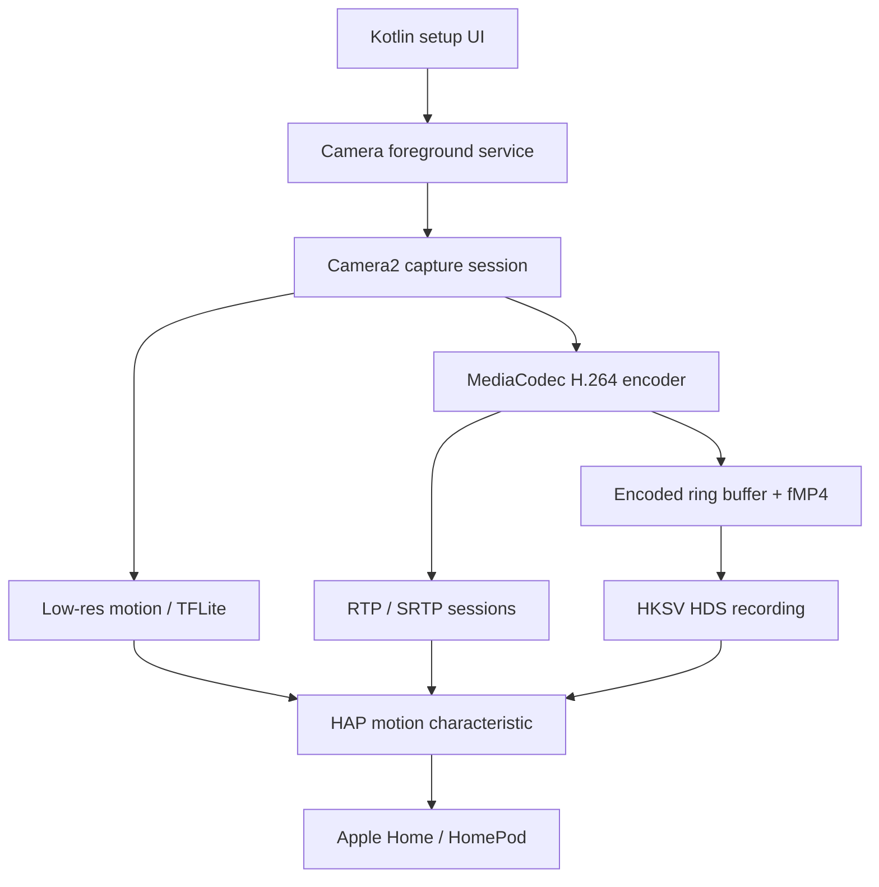

# Android HomeKit Camera — Kotlin Technical Design

**Status:** implementation-ready architecture proposal; protocol validation outstanding  
**Research date:** 2026-11-14  
**Initial target:** Samsung Galaxy S24 (Android 15+), reusable on other Android devices  
**Product objective:** turn a retired phone into a local, screen-off, direct-pairing Apple Home camera with on-device detection and, ultimately, HomeKit Secure Video (HKSV). No Scrypted or other always-on bridge.

## 1. Executive decisions

1. **Direct HomeKit accessory, not an Apple Home controller.** The app implements HAP over IP and advertises itself with mDNS; the Home app pairs to the phone.
2. **Native Kotlin app.** Camera2, MediaCodec, Android Keystore, NsdManager/mDNS, foreground service; isolated protocol and media modules. A limited NDK component is permitted if SRTP/crypto interoperability demands it.
3. **Port Pylo's concepts and protocol test vectors, not its Swift UI or AVFoundation components.** Its permissively licensed reference implementation is directly relevant but cannot be dropped into Kotlin unchanged.
4. **Two protocol milestones:** legacy HAP camera live-view and existing HKSV, then investigate Apple's *June 2026 developer-preview* HKSV compatibility guide. Do not conflate these wire formats or promise that the preview is deployed in current Home hubs.
5. **Local inference** is owned by each phone. The hub receives motion characteristics and video; it does not run our detection pipeline.
6. **Prefer correctness over zero-copy claims.** Validate one capture feeding encoder plus a low-resolution analysis surface, and a buffered recording path, before optimizing.

## 2. Pylo source review

Reviewed source: [`tfausak/Pylo`](https://github.com/tfausak/Pylo), `main` commit `0e2ae33e1a370c0971d9a2a7c6d023633f71a5a1` (shallow checkout). The project is licensed **0BSD** (`LICENSE.txt`); retain provenance for adapted code and independently check licenses of third-party dependencies.

| Pylo source | What it actually does | Kotlin equivalent |
|---|---|---|
| `Packages/HAP/Sources/HAP/HAPServer.swift`, `HAPConnection.swift`, `PairSetup.swift`, `PairVerify.swift` | Accessory HTTP transport, encrypted sessions, SRP pairing and verification | `:hap-core`, using JCA/BC primitives and encrypted socket state machine |
| `Packages/HAP/.../PairingStore.swift`, `DeviceIdentity.swift`, `KeyStore.swift` | Accessory identity, trusted controllers and key persistence | `:hap-identity` + Android Keystore-encrypted persistent storage |
| `Pylo/HAPCameraAccessory.swift`, `+JSON.swift`, `+StreamConfig.swift`, `+Streaming.swift` | Camera service/characteristics, stream negotiation, SRTP endpoint setup, status and motion | `:hap-camera` camera accessory model and stream controller |
| `Packages/SRTP/Sources/SRTP/SRTPContext.swift` | RTP packet protection | `:media-srtp`, tested with known-answer vectors |
| `Packages/HAP/.../HAPDataStream.swift`, `HDSConnection.swift`, `HDSCodec.swift` | Separate HKSV HDS TCP channel, encrypted with keys derived from pairing session | `:hksv-legacy` encrypted data-stream state machine |
| `Packages/FragmentedMP4/.../FragmentedMP4Writer.swift` | H.264 sample packaging into fragmented MP4, short fragments, circular prebuffer | `:media-buffer` parser/muxer and bounded ring buffer |
| `Packages/Sensors/.../VideoMotionDetector.swift` | Downsampled grayscale frame difference with threshold and calm-period hysteresis | `:detection` fast CPU motion gate; optional TFLite object classifier |
| `Packages/Streaming/.../CameraStreamSession.swift`, `MonitoringCaptureSession.swift` | AVFoundation capture and switch between live and armed monitoring sessions | `:capture` Camera2 session and stream lifecycle without switching capture unnecessarily |

**Specific lessons from source:** Pylo's `FragmentRingBuffer` has fixed capacity 6; its writer emits fragments at keyframe boundaries after a ~3.5 s target, under an intended 4 s hub limit. Its HDS transport derives distinct read/write encryption keys from pair-verify material. Its video motion detector reuses grayscale scratch buffers and resets baseline on frame geometry changes. These are useful behavioral references, *not* unverified assumptions about the Android implementation.

**Important caveat:** Pylo's source proves a working design pattern but not Android compatibility, multi-client throughput, current-home-hub compatibility, or full compliance with Apple's emerging 2026 protocol.

## 3. Apple protocol tracks

### Track A — existing HAP camera/HKSV (first shipping target)

- HAP IP accessory discovery, SRP pairing, encrypted event subscriptions and accessory characteristics.
- Camera RTP negotiation via Setup Endpoints / Selected RTP Stream Configuration, negotiated H.264 RTP/SRTP, snapshots, optional audio and two-way talk.
- Motion sensor service emits a transition and then clears after hysteresis; recording configuration and selected stream parameters are persisted.
- For HKSV, implement HAP Data Stream (HDS), recording management, pre-event buffer, fragmented MP4 transmission and home-hub backpressure/cancellation. Reproduce Pylo's behavior with independently validated test vectors.
- Do not claim HKSV until recordings are visible and playable in Apple Home, including the first seconds before motion.

### Track B — Apple June 2026 developer-preview guide (separate investigation)

Apple's [HomeKit Secure Video Open Source Compatibility Guide](https://developer.apple.com/download/files/HomeKit-Secure-Video-Open-Source-Compatibility-Guide.pdf) is explicitly labeled **Developer Preview** (2026-06-03), complements HAP R17+, and describes a materially different/more demanding target: **three concurrent encoding tiers**, **HEVC**, **Opus**, **at least five concurrent RTP sessions**, **at least six concurrent WebRTC sessions**, camera buffer-management characteristics and CMAF ingest key/certificate flows. We must *not* assert these are requirements for all deployed older HKSV accessories. They are a feasibility and forward-compatibility risk for retired phones.

**Gate:** determine which protocol profile current Apple Home hubs actually request from a freshly paired Pylo and from our prototype. Keep profile-specific code behind `CameraProtocolProfile` rather than hardwiring the preview requirements into MVP.

## 4. Runtime architecture



**Interfaces (Kotlin, illustrative):**

```kotlin
interface CameraEngine {
    val state: StateFlow<CameraState>
    suspend fun start(profile: CaptureProfile)
    suspend fun stop()
    fun encodedVideo(): Flow<EncodedAccessUnit>
    fun analysisFrames(): Flow<AnalysisFrame>
}

interface MotionDetector {
    fun observe(frames: Flow<AnalysisFrame>): Flow<MotionEvent>
}

interface CameraAccessory {
    suspend fun publishMotion(active: Boolean)
    suspend fun startLiveStream(request: StreamRequest): StreamHandle
    suspend fun openRecording(request: RecordingRequest): RecordingHandle
}
```

Avoid shared unbounded Flows of raw frames. Use bounded channels/backpressure, a fixed `ImageReader` buffer pool, explicit `Image.close()` ownership, and timestamped encoded units. Design multiple client RTP packetizers over the same encoded stream whenever compatible; negotiate extra encodes only when needed.

### Suggested Gradle modules

`app`, `capture`, `media-codec`, `media-rtp`, `media-srtp`, `media-buffer`, `detection`, `hap-core`, `hap-camera`, `hksv-legacy`, `settings`, `test-fixtures`.

No mandatory local web server or RTSP component for MVP. Add optional `rtsp` and `onvif` modules after the direct HomeKit path works.

## 5. Camera and inference pipeline

- Start with back-facing wide camera, landscape 1080p/15–30 FPS, H.264 baseline/main negotiated as supported, conservative bitrate, audio disabled for initial proof.
- Camera2 capture session: output to MediaCodec input surface and a YUV `ImageReader` analysis surface. If simultaneous output combinations fail on a given device, downgrade the analysis resolution or use a GPU resampling path; test S24 specifically.
- Motion fast path: Y plane sampled at ~3–5 FPS and downscaled to ~320×180/240; illumination-adaptive threshold, minimum contiguous change, exclusion polygons, onset/clear hysteresis.
- Classifier is **optional** and only runs on motion-triggered candidate frames. Start with a model available under a verified license (e.g. TFLite), tune person/pet labels and quantization on device. Prefer GPU/NNAPI only after benchmarking CPU latency, thermal headroom and compatibility.
- Keep object detections as app metadata initially; HKSV/Home handles its own clip analysis and object labels. Do not promise custom object classifications become native Apple Home categories.
- Event transitions must be debounced; expose `motion active` plus clear event in HAP. Respect Apple's "off/detect/stream/record" operating controls and privacy state.

## 6. Recording buffer and streaming

- Maintain a bounded **encoded** prebuffer, initial goal 4–8 seconds plus live continuation; never buffer full-resolution raw frames.
- Enforce codec-specific configuration continuity (SPS/PPS, sequence headers, timestamps), keyframe interval ~1–2 s, monotonic PTS/DTS, fragment sequence and discontinuity behavior.
- On motion, preserve pre-trigger media and send the required HDS messages/fragment sequence. Build a reproducible MP4/HDS parser test harness before Apple Home integration.
- For live view, implement packetization (H.264 NAL fragmentation and timestamps), negotiated SRTP keys/salts, RTCP feedback/teardown, endpoint lifetime and concurrent stream accounting. Never reuse transport nonce/key material across sessions.
- Recording-armed monitoring should be independent of an actively open Home live view; opening/closing the live view must not erase the prebuffer.
- Handle audio codec compatibility as a separate milestone; Pylo's existing HKSV writer uses AAC-ELD while Apple's 2026 preview specifies Opus. Keep profile-specific audio codecs isolated.

## 7. Android lifecycle and operating limits

- Use a visible, user-initiated **camera foreground service** with `CAMERA` and `FOREGROUND_SERVICE_CAMERA` permissions and correct `foregroundServiceType`. Microphone requires its corresponding permissions/type if enabled.
- Once legitimately started while the app is visible, capture can continue with the display off; test lock/unlock, idle/Doze, Wi-Fi sleep, charging, low memory, thermal throttling and permissions revocation.
- **Android 15+ does not allow a camera foreground service to be launched directly from `BOOT_COMPLETED`.** A crash/reboot can require user interaction; a watchdog cannot bypass the platform's background-start restrictions. Present explicit `Needs attention` state, not a fake auto-restart guarantee.
- Keep a small permanent foreground notification, optional wake/Wi-Fi locks only where measurement shows necessity, and no always-on display. Add thermal bitrate/FPS degradation and battery protection guidance.
- Samsung-specific battery policies and USB power behavior need real-device endurance testing; monitor battery percentage, temperature, CPU and encoder drops without retaining sensitive video in logs.

## 8. Security/privacy model

1. Pairing only during explicit setup; display a newly generated setup code/QR and close the pairing window afterwards.
2. HAP identity keys and pairing secrets held in Keystore-backed encrypted local storage where feasible; define backup/reset and pairing wipe semantics. Never reuse one phone's accessory identity on a second phone.
3. Authenticate and encrypt every accessory control/media session per protocol; no unauthenticated HTTP snapshots, internet listening socket, cloud telemetry, or hardcoded pairing PINs.
4. Restrict bind interfaces to LAN; prevent accidental UPnP exposure. Include local-network diagnostics but no vendor account.
5. Clear buffered media on privacy-off, unpair, explicit stop, and appropriate recording-mode transitions; document what remains in memory. Prefer RAM ring buffers with zero disk persistence by default.
6. Add mutation fuzzing / malformed TLV tests, replay protection, HKDF/SRP/SRTP known-answer vectors, and verification of pairing permissions.

## 9. Delivery plan and acceptance gates

| Phase | Deliverable | Acceptance criteria |
|---|---|---|
| 0: source/protocol harness | HAP test vectors, Pylo trace capture plan, device capability probe | SRP/pair-verify/TLV tests pass; S24 camera combinations recorded; Apple Home test matrix defined |
| 1: capture daemon | Native camera + H.264 pipeline with screen off | 8-hour screen-off stream stable, no leaking `ImageReader` buffers; foreground notification and manual restart tested |
| 2: direct HomeKit live view | mDNS, pairing, encrypted HAP, snapshot, SRTP live view | Apple Home pairs via QR, shows live video on LAN and via home hub, reconnects after lock/unlock |
| 3: local detection | Frame-difference motion events, zones, optional lightweight classifier | Events appear in Apple Home; false-alert/latency tests with daylight, nighttime and pets |
| 4: HKSV | Ring buffer, HDS, fMP4 recording delegate | Motion-triggered recording appears in Apple Home timeline with pre-motion footage; repeated clips survive view open/close |
| 5: appliance hardening | thermal policy, pairing reset, Wi-Fi reconnection, optional audio, observability | 72-hour soak; documented recovery behavior from reboot/kill/disconnect; power and heat measurements |
| 6: optional | RTSP/ONVIF, multiple profiles, 2026 preview compatibility | Each capability independently tested and user-toggleable |

**Measured targets (proposed, not established facts):** ≤2 s motion-to-event on LAN, ≤3 s typical live-view start after warm connection, no buffer growth over 72 h, no sustained thermal throttling at default settings. Measure device temperature and battery-health impact before claiming 24/7 suitability.

### Test matrix

- Galaxy S24 running its actual firmware; one older midrange Android for portability.
- Apple Home on iPhone, HomePod as hub; test local Wi-Fi and cellular remote view.
- Pair/unpair/re-pair, camera asleep, Wi-Fi IP change, network loss, lock/unlock, app swipe, reboot, charger disconnection, storage low, permission revoked, simultaneous viewers.
- HKSV: motion onset and clear, consecutive clips, prebuffer, long motion, no motion, user changing recording mode, Apple hub restart, codec renegotiation, corrupt/truncated fragments.

## 10. Open questions / research spikes

1. **HAP protocol baseline:** What exact capability sets are requested by current Apple Home/HomePod software? Capture comparison against Pylo before selecting live-view codec details.
2. **Protocol reuse:** Port Pylo's 0BSD code structure vs write Kotlin HAP core from spec and use Pylo as executable oracle. Prefer Kotlin core for long-term maintenance, but first benchmark effort against existing Java libraries (notably HAP-Java, whose camera RTP support is incomplete).
3. **HKSV compatibility:** Does Apple's June 2026 developer-preview guide represent upcoming behavior only? Its 3-tier encoders, HEVC/Opus and 5+6 sessions cannot be silently assumed feasible on the S24. Gate behind a separate compatibility experiment.
4. **Concurrency:** Verify Galaxy S24 simultaneous encode + analysis, number of hardware codecs, sustained bitrate and battery temperature. Android's API provides capability interrogation but not a promise of stable 24/7 output.
5. **Energy economics:** Test 720p versus 1080p, motion cadence and model choice; old battery health, charger quality and heat may dominate.

## 11. Build-agent starting instructions

1. Create the Gradle/Kotlin skeleton and pure JVM `hap-core` with test-only pairing state machine; do **not** start by writing the whole HKSV stack.
2. Import protocol vectors and a Pylo-based interoperability checklist, recording Pylo commit and license provenance.
3. Build `capture` and a temporary LAN diagnostic stream with screen-off service, test on S24, then remove or feature-gate the diagnostic endpoint.
4. Integrate HAP accessory discovery/pairing and a simple switch or motion sensor **before** tackling camera streaming.
5. Add H.264 SRTP live view and automated retransmission/RTCP tests; use Apple Home as a black-box compatibility target.
6. Implement the HKSV fragment/HDS path only after pairing/live view and motion pass real-device gates.
7. Keep a `PROTOCOL_COMPATIBILITY.md` decision log distinguishing observed behavior, protocol spec requirement, source-code inference and hypothesis.

## 12. Primary references

- [Pylo repository](https://github.com/tfausak/Pylo) — reviewed code at commit `0e2ae33e1a370c0971d9a2a7c6d023633f71a5a1`.
- [Apple — HKSV Open Source Compatibility Guide, developer preview (June 2026)](https://developer.apple.com/download/files/HomeKit-Secure-Video-Open-Source-Compatibility-Guide.pdf).
- [Apple — developing home apps/accessories](https://developer.apple.com/apple-home/).
- [HAP-NodeJS CameraRecordingDelegate](https://developers.homebridge.io/hap-nodejs/interfaces/CameraRecordingDelegate.html) and [Camera example](https://github.com/homebridge/HAP-NodeJS/blob/latest/src/accessories/Camera_accessory.ts).
- [Android — camera foreground service limitations](https://developer.android.com/develop/background-work/services/fgs/restrictions-bg-start) and [Android 15 background boot restrictions](https://developer.android.com/about/versions/15/changes/foreground-service-types).
- [Android — CameraX use-case combinations](https://developer.android.com/media/camera/camerax/architecture) and [ImageAnalysis](https://developer.android.com/media/camera/camerax/analyze).

---

**Bottom line:** Direct, local, on-device Kotlin HomeKit camera is a plausible engineering project, not a turnkey SDK integration. The highest-risk work is HomeKit camera media/session correctness and HKSV, *not* motion classification. Build and verify the protocol incrementally, with Pylo as a valuable reference implementation and Apple's 2026 preview treated as a separate future-facing target.
